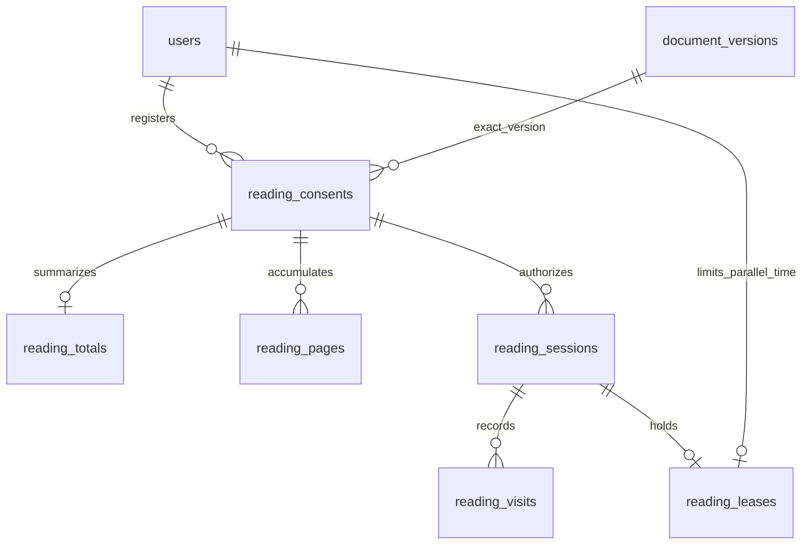

# Reading progress and reader analytics — BETA C2

Tools now includes Reading progress (the Manuscript spine) and Reader analytics.
Both use `LeftCard`: existing pinning, dragging, collision packing, focus/toggle
and account/exact-version restoration. The previous four-card restore cap is
replaced by a bounded 32-record input limit, allowing all six tools together.

The spine puts section nodes at canonical page/fraction positions and readers at
their current or last recorded page. It packs labels separately with leaders;
clustered dots retain their true vertical positions with small horizontal offsets.
Its legend distinguishes position from estimated completion. Reader clicks
select/focus the one analytics card; section clicks use native PDF.js destinations,
including in-page starts. Backward navigation never reduces completed progress.

Analytics shows position, furthest visited page, measured active viewing time,
considered-read pages, activity date and estimated section completion. Section
dwell bars use the reader's existing review color. Pages expands sections or All
pages into paged activity lists: state, time and last visit. Longer viewing does not establish comprehension;
there is no special long-dwell marker on page rows.

## Author controls, privacy and identity

Tracking starts **on** for every eligible reader. Opening the PDF automatically
registers an exact-version reading session. GET requests alone do not write history.
Only document authors control tracking: **Tools > Review settings > Reading activity**
has document On/Off and per-reader On/Paused. Both apply across the document's PDF
versions. Readers cannot enable, disable, pause or erase tracking through the cards
or API. Off/Paused stops new writes and keeps past history. Policy generations
invalidate in-flight sessions and release their leases.

Both cards are available to all document readers. Authors can inspect eligible
readers with current document access; everyone else sees only themselves, in both
shared and isolated review. Comment filters never broaden analytics access. Services
recheck permissions transactionally; endpoints use default-deny auth and CSRF.
The historical `reading_consents` table now registers exact-version metadata and
generations; its old name/consented_at column are retained for additive compatibility,
not as evidence of personal opt-in. Migration 12 supersedes the old personal controls.

## Time and completion model

- **Visited**: a stable visible page receives eligible active time.
- **Currently viewing**: live Socket.IO page/spread presence, with last saved position
  as fallback. Time still requires the separate exclusive reading lease.
- **Considered read**: accumulated eligible time reaches
  `max(5 seconds, words × 60 / 400)`. Revisits and later sessions add time.

PDF.js extracts approximate word counts; only counts are sent, never page text.
Image-only pages use the short-page minimum; extraction failure retains measured
time but leaves completion unknown. These are estimates, not proof of reading.
Policy constants live centrally in `review/reading.py` and are returned to the
client. Read timestamps are sticky; a future estimation-policy change should
explicitly rebuild derived completion values rather than silently reinterpret them.

The client uses `performance.now()` and one-second samples. Eligibility requires
author-enabled tracking, visible/focused document, recent input (60-second idle cutoff), online
status, joined realtime connection and a valid reading lease. Scrolling plus the
following 600ms, page/pair changes and timer gaps over 2.5 seconds are excluded.
Hidden/focus/pagehide lifecycle events stop/reset timing and attempt a final
release. Background suspension never produces catch-up time. Slow continuous
scrolling, conservative idle detection and lost updates can underestimate time.

`presence.js::viewingPages` factors the existing live-avatar page/spread logic into
one shared source, as requested. Only that current page/adjacent pair participates,
even when more pages fit on screen. Visible areas split **one** elapsed-time budget;
offscreen partners get zero. This is not eye tracking or independent full-rate
time for both pages. The live-avatar presentation and its existing permissions
are unchanged. Reading activity is never inferred from old presence.

## Migration 11 and bounded persistence

Migration 11 adds six tables; migration 12 adds default-on
`document_review_settings.reading_tracking_enabled` and document/user keyed
`document_reading_pauses`. It preserves all history, supersedes previous personal
Off/Paused states, advances generations and releases old leases. Earlier migrations
remain unchanged:

| Table | Purpose |
| --- | --- |
| `reading_consents` | User/exact version, status/generation, declared page count, consent dates |
| `reading_totals` | Incremental measured time, visited/read counts, furthest/last position and dates |
| `reading_pages` | Indexed user/version/page, cumulative time, word count, visit/read dates and counts |
| `reading_sessions` | Server-issued user/version session, consent generation and acknowledged sequence |
| `reading_leases` | One user-wide active time budget across tabs, versions and devices |
| `reading_visits` | Session/visit index/page accumulated time and recorded dates |



The client normally batches every 15 seconds, at most 32 visit rows/16KB.
Sequences make duplicate delivery idempotent. Invalid/out-of-order or stale
sessions fail. A single SQLite write transaction updates visits, page/reader
totals and the lease watermark. Accepted batch time is bounded by 20 seconds and
the elapsed server receipt window, whichever is smaller. Overclaimed allocations
are proportionally clamped. A 25-second exclusive global lease prevents concurrent
full-rate accumulation by one reader, including different versions/devices.
An abandoned lease may delay a successor until expiry; release normally avoids it.

Page counts and word counts are bounded browser observations, not a new trusted
server PDF parser or forensic measurement. They cannot change another reader's
thresholds; every record is tied to an immutable version FK. No OCR, persistent
PDF caching, offline queue, service worker or reconnect replay is added. Failed
updates discard unacknowledged in-memory timing. Crash/background shutdown or
disconnection can lose the last batch (normally up to 15 seconds). Visit/read
dates are **server batch-receipt timestamps**, not exact first-view timestamps.
Visit indices identify stable active viewing bouts; resuming after a scroll or
idle pause can produce a new bout on the same page without increasing pages visited.

Summaries use incrementally maintained totals and at most 100 readers per page.
After committed batches, `reading.changed` WebSocket invalidations go only to
currently authorized authors and the affected reader; the payload contains no
reader identity or analytics. Open cards fetch canonical data immediately. Policy
changes notify everyone on every affected version, even with tools closed, so
tracking stops promptly. Presence moves reader markers immediately. Persisted time
and completion update after 15-second batches, not on every second. A 30-second
visible/open-card poll remains as recovery. Reconnect also refreshes policy. Page lists use 50-row windows (server maximum 100). Section calculations
use ordered page prefix sums and canonical boundary fractions; page-only requests
skip rebuilding them. A shared page's time is apportioned by section fraction.
Time outside mapped sections stays in the total. History is retained when tracking is paused/off; no reader erase control or
automatic retention job exists in this revision.

## Verification and operating limits

```powershell
.\.venv\Scripts\python.exe -m unittest discover -s tests -q
.\.venv\Scripts\python.exe tests/browser_sanity.py --reading-ui
.\.venv\Scripts\python.exe tests/browser_sanity.py --tools-menu
```

174 unit/security tests pass. Checks cover default-on registration and author-only document/reader controls,
thresholds/revisits, weighted spreads, duplicate batches, simultaneous tabs and
versions, lease expiry, policy changes across versions, targeted WebSocket delivery, stale sessions, permissions/revocation,
CSRF, long dwell, page windows and fractional section boundaries. Browser checks
include a real foreground visit and author Pause, hidden/unfocused/idle/disconnected
eligibility, suspended-clock gaps, clustered labels, reader/page navigation,
shared pinning and six-card restoration.

Narrow visuals are inspected in ignored `tests/visual-artifacts/` screenshots:
`reading-progress-spine.png`, `reader-analytics-sections.png`, and
`reader-analytics-pages.png`. Physical iPhone lifecycle testing remains manual.
Existing PDF.js vendor/zoom/pan code has not been edited. No staging, commits,
pushes, SSH or production deployment.

The local database was backed up online before migration 12; integrity/FK checks,
prior migrations, immutable versions and existing reading history were verified afterward. The active
test server uses http://127.0.0.1:5000/; the public tunnel is stopped. Reload the
viewer after the local restart. No production deployment is included.

Sources: [Page Visibility API](https://developer.mozilla.org/en-US/docs/Web/API/Page_Visibility_API),
[PDF.js page text API](https://mozilla.github.io/pdf.js/api/draft/module-pdfjsLib-PDFPageProxy.html).

## Page metrics and completion labels

Pages rows use the page number, two lines on the left (state with active time,
then last visit), and two small right-aligned lines (word count, then `ERT #s`).
Existing recorded counts/thresholds are reused; missing counts are extracted lazily
from this exact PDF through the tracker's shared cache, at most four requests at a
time for the requested page window. Inspecting unread pages does not create activity.
Failed extraction shows unavailable; zero-word pages retain the five-second minimum.
States remain Not yet viewed (no accepted time), Partially viewed (some time, below
threshold or unknown count), and Considered read (threshold reached).

The Manuscript legend now shows considered-read pages / total and the completion
percentage. Current position remains on the marker and in the legend tooltip. The
localhost report of 1/4 with three completed pages was a current-position label,
not corrupted totals: both stored totals and page records showed three completed
pages. The final Pages group no longer duplicates the activity footer's divider.

## Stable analytics view and reload restoration

The selected reader, Pages/Sections tab and expanded page groups are saved under
an account/exact-version scoped browser key. Only these UI choices are stored;
measured activity remains server-side. Saved reader selection is validated against
the authorized roster on load. Unavailable storage falls back to normal defaults.

Routine reading/presence updates retain tab, group, page-row and statistics DOM
nodes. Existing page windows stay visible while their values refresh; expansion,
loaded pagination and focus survive. Only changed reader/view or section structure
rebuilds the content. Closed groups defer fetching their stale windows until opened.
All expanded groups have one 10px gap between the final page and their divider:
section groups supply it as bottom padding; All pages uses the activity footer’s
10px top margin. Nested list/row bottom padding is removed to avoid stacking. The former long-dwell
left-edge marker is removed. Browser acceptance verifies stable element identity
through a WebSocket-triggered canonical refresh and view restoration after reload.
